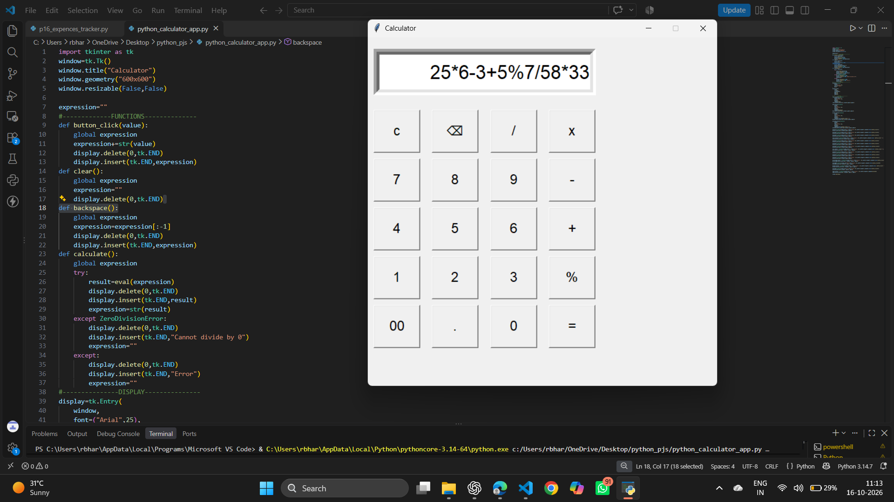

# 🧮 Tkinter Calculator App

A simple and interactive desktop calculator built using **Python and Tkinter**. This application provides a graphical user interface (GUI) for performing arithmetic operations with easy-to-use buttons.

## 📸 Application Preview
Here is a preview of my Tkinter Calculator App.



## ✨ Features

* ➕ **Basic Arithmetic:** Addition, subtraction, multiplication, and division.
* 🧮 **Modulo Operation:** Calculates the remainder of a division.
* 🔢 **Decimal Support:** Perform calculations with decimal numbers.
* 🧹 **Clear Display:** Clear the current expression.
* ⌫ **Backspace:** Delete the last character entered.
* ⚠️ **Error Handling:** Handles invalid expressions and division by zero.
* 🖥️ **User-Friendly Interface:** Simple graphical interface with interactive buttons.

## 🛠️ Technologies Used

* **Language:** Python
* **GUI Library:** Tkinter

## 🚀 Getting Started

Follow these steps to run the calculator on your computer.

### Prerequisites

* Python 3 installed on your computer.
* Tkinter installed and available in your Python environment.

> Tkinter is included with many standard Python installations. On some Linux systems, it may need to be installed separately.

### Installation

**1. Clone the repository**

```bash
git clone https://github.com/BHARATHCHANDU06/tkinter-calculator-app.git
```

**2. Open the project folder**

```bash
cd tkinter-calculator-app
```

**3. Run the application**

```bash
python calculator.py
```

The calculator window will open, and you can start performing calculations.

## 📚 Concepts Practiced

Through this project, I practiced:

* Python functions
* Global variables
* Tkinter widgets and GUI layout
* Button-click event handling
* Arithmetic expressions
* Exception handling
* Building interactive desktop applications

## 🔮 Future Improvements

* Add keyboard input support.
* Improve the user interface and visual design.
* Add calculation history.
* Improve expression validation and calculation safety.

## 👨‍💻 Author

**Bharath Chandu**

* **GitHub:** [BHARATHCHANDU06](https://github.com/BHARATHCHANDU06)
* **Project Repository:** [Tkinter Calculator App](https://github.com/BHARATHCHANDU06/tkinter-calculator-app)

---

⭐ If you find this project useful, consider giving the repository a star!
